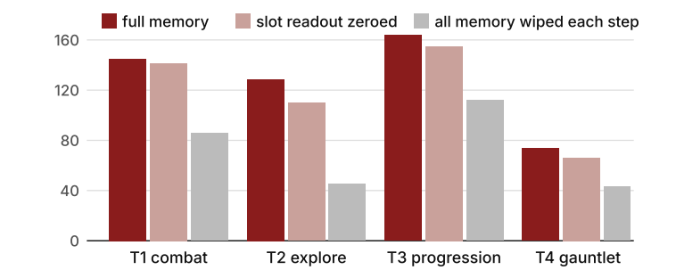

# BBB (Bictor Bon Boom)

**Budgeted, position-anchored spatial memory for zero-shot DOOM play.**
Our entry for *Yugaantar 2026 · DevForge, Track 1: "Can It Play DOOM?"*

📄 **[2-page project brief (PDF)](docs/brief.pdf)** · [design notes](docs/BRIEF.md) · [environment findings](docs/FINDINGS.md) · [experiment log](docs/EXPERIMENTS.md)

BBB (Bictor Bon Boom) is a 1.07M-parameter recurrent agent. It plays DOOM levels it has never seen, using only the official
ego-centric telemetry: rays, visible entities and vitals. It gets no pixels and no global coordinates. Open-world games keep a fixed budget of
world chunks loaded, streaming chunks in and out as the player moves. Our agent manages its memory the same way. It has **32 memory slots**, each
**anchored to a pose that the agent estimates for itself** with a learned odometry network. When the agent reaches unmapped space, a new slot
is created; when all 32 are in use, the **least relevant slot (by a learned score) is overwritten**. Slots are read by
attention from the agent's current point of view. This lets the agent remember "a locked door behind me and to the left,
three rooms ago" without being given a map.


## Highlights

- **Our own recurrent PPO** (no RL library) with an **asymmetric privileged critic**, separate extrinsic and intrinsic
  value heads, and a reward built to match the official scoring categories.
- **Our own procedural map factory**: room graphs, doors, one to three key-and-lock chains, switch or walk-over exits,
  uneven floors. A solver checks every level, and Freedoom maps add variety.
- **Curriculum Director**: trains most on scenarios the agent solves about half the time, replays seeds it failed ("nemesis"
  episodes) and mirrors episodes left to right at random.
- **Fast enough to spare**: under 1 ms per decision on one CPU thread (the budget is 40 ms), with 4.3 MB of weights.
- **Every action comes from the network.** The code around it only checks inputs and outputs. It contains no rules, pathfinding or aim code.

## Results

Evaluation used 240 generated maps that were never used in training, plus 3 Freedoom maps, across all four tiers (249 episodes, fixed seeds). Each policy ran through the real
`submission/agent.py` and was scored by our local copy of the scorer (tiers weighted 1:2:3:4). The organisers' exact weights are not public, so the
absolute numbers are estimates.

| Tier | 40.5M decisions | Main run, 62.0M | Aim run, 61.0M |
|---|---|---|---|
| 1 Combat | 139 · exit 88% | 140 · exit 88% | 140 · exit 88% |
| 2 Exploration | 114 · exit 60% | 115 · exit 58% | **127 · exit 67%** |
| 3 Progression | 145 · exit 58% | **160 · exit 72%** | 153 · exit 68% |
| 4 Gauntlet | 97 · exit 33% | 107 · exit 39% | 107 · exit 42% |
| **Weighted** | 118.8 | 127.5 (+8.6, 95% CI 0.5 to 17.1) | **128.3** (+9.5, 95% CI 1.0 to 18.1) |

**Weights now in `submission/`:** the main run's best save, 58.4M decisions. On a second set of 249 episodes with new
maps it scored 136.6, against 135.8 for the aim run at 61.0M and 132.5 for the 40.5M checkpoint. All three are within
chance of each other, as were the final checkpoints (71.9M and 72.3M). See [using different models](#using-different-models).

**Does the agent use its memory?** Yes (ablations of the main run at 34.8M decisions; we trained no no-memory baseline). Wiping all memory at every step costs **50 points** (95% CI 36 to 65). Zeroing only
the slot readout costs **10 points** (95% CI 1 to 20), mostly in exploration and progression, which is where remembering
places should matter.



**Known weaknesses:** switch exits (31–52% exit rate, compared with 61–100% for walk-over exits, measured on the 40.5M model), deaths in tier 4 (36–41% of episodes),
and a low kill rate (about 15% of enemies).

## Setup

On macOS the default shell (zsh) does not ignore comments you paste; run the first line once per terminal.

```bash
setopt interactivecomments                                     # macOS zsh only: allow the comments below
git lfs install                                                # once per computer, so model files download
git clone https://github.com/VarchasHV/NOVA.git && cd NOVA     # get the code and the model
git lfs pull                                                   # fetch the model file if it is only a pointer
uv sync                                                        # install Python packages (CUDA build on Linux and Windows)
uv run python validate.py                                      # official checks on the model in submission/
```

If any output says `using an UNTRAINED network`, the model file did not download: run `git lfs pull` again.
An untrained network plays very badly.

## Training guide

Training needs an NVIDIA GPU. Our runs took 14 hours on an RTX 3050 laptop (about 72M decisions); `configs/full.yaml`
runs for 16 hours unless you set `max_hours`.

### 1. Check the computer

```bash
uv run python tools/check_setup.py                             # GPU, speed test, suggested worker settings
uv run python -m training.train --config configs/smoke.yaml    # short run of the whole pipeline, up to 1 hour
```

### 2. Train

```bash
uv run python -m training.train --config configs/full.yaml                      # main run; saves to runs/full/
uv run python -m training.train --config configs/full.yaml                      # the same command again resumes it
uv run python -m training.train --config configs/full.yaml --set max_hours=14   # total hours, including time already trained
uv run python -m training.train --config configs/full.yaml --set num_workers=10 # use the value check_setup.py suggests
uv run tensorboard --logdir runs                                                # training curves at http://localhost:6006
```

`Ctrl+C` saves a checkpoint and stops. If you started with `--set` options, pass the same ones when resuming.

| File in `runs/<name>/` | What it is |
|---|---|
| `ckpt_latest.pt` | newest state; resuming uses this |
| `best.pt` | best score so far on the 27-game test that runs during training |
| `ckpt_XXXXXM.pt` | hourly snapshots, named by millions of decisions |
| `eval.jsonl` | every test score |

### 3. Continue from a trained checkpoint

Copy it into a new run folder, so the original stays untouched. `max_hours` must be larger than the hours the
checkpoint has already trained.

```bash
mkdir -p runs/more && cp runs/full/best.pt runs/more/ckpt_latest.pt                              # start a copy
uv run python -m training.train --config configs/full.yaml --run-name more --set max_hours=16    # keep training it
uv run python -m training.train --config configs/asus_aim.yaml --run-name more --set max_hours=16  # or: with aiming and switch practice
```

Only training checkpoints can be continued. The model files in git hold the network alone, without the optimiser or critic.

### 4. Other experiments

Each file in `configs/` is one experiment ([which is which](training/README.md#configs)).

```bash
uv run python -m training.train --config configs/asus_aim.yaml       # damage reward and more switch exits
uv run python -m training.train --config configs/gru_baseline.yaml   # no spatial memory (not run by us)
uv run python -m training.train --config configs/memory_k64.yaml     # 64 memory slots (not run by us)
```

### 5. Train on other laptops over SSH

Set up SSH first ([docs/TRAINING.md](docs/TRAINING.md)). Replace `acer` with your SSH alias.

```bash
tools/remote.sh setup acer                        # copy the code, install packages, check speed
tools/remote.sh start acer configs/full.yaml      # start or resume training in tmux
tools/remote.sh status acer                       # GPU load and the last log lines
tools/remote.sh stop acer                         # save a checkpoint and stop
tools/remote.sh fetch acer                        # copy checkpoints back to runs/acer/
python3 tools/dashboard.py --hosts acer           # live page at http://localhost:8765
uv run python tools/watch.py acer --best          # watch that laptop's best checkpoint play
```

## Using different models

The agent always loads `submission/weights/model.pt`. Earlier versions of that file are kept in git history.

| Commit | Model | Decisions | File hash starts |
|---|---|---|---|
| `c6dbfd5` | main run, best save | 58.4M | `a5b6f43e` |
| `a7b9bcc` | aim run | 61.0M | `f4bc20e4` |
| `9e9a299` | main run | 40.5M | `824eefb4` |
| `f00a8f1` | main run | 24.9M | `80b3fc46` |

All four sample their actions at temperature 0.5.

### Get an earlier model

This needs the full history (not a `--depth 1` clone).

```bash
mkdir -p runs/models                                                                      # a folder git ignores
git cat-file --filters a7b9bcc:submission/weights/model.pt > runs/models/aim_61M.pt       # the aim model
git cat-file --filters 9e9a299:submission/weights/model.pt > runs/models/main_40M.pt      # the 40.5M model
shasum -a 256 runs/models/*.pt                                                            # compare with the table
```

### Test a model without installing it

```bash
uv run python -m evaluation.run_heldout                                                   # the installed model, 27 games
uv run python -m evaluation.run_heldout --weights runs/models/aim_61M.pt                  # another model file
uv run python -m evaluation.run_heldout --weights runs/models/aim_61M.pt --maps-per-tier 12 --episodes 3   # more games, steadier score
uv run python -m evaluation.run_heldout --weights runs/models/aim_61M.pt --variety 1      # maps with steps and ledges
uv run python -m evaluation.run_heldout --ckpt runs/full/best.pt --temperature 0.5        # a training checkpoint
uv run python tools/viz_topdown.py --weights runs/models/aim_61M.pt --tier 3 --out episode.png   # top-down picture of one game
uv run python tools/watch.py --ckpt runs/models/aim_61M.pt                                # watch it play (uses temperature 1.0)
```

Compare models on the same options only. A 27-game score can swing by about 20 points, so small gaps mean little.

### Install a model

```bash
cp runs/models/aim_61M.pt submission/weights/model.pt                       # use a downloaded model
uv run python -m training.export --ckpt runs/full/best.pt --temperature 0.5 # or export a checkpoint (the default temperature is 1.0)
uv run python validate.py                                                   # official checks
uv run python validate.py --map path/to/map.wad:MAP01                       # try it on your own map
uv run python -m evaluation.profile_latency                                 # decision speed on one CPU thread
git checkout -- submission/weights/model.pt                                 # undo: go back to the committed model
```

To publish it, commit `submission/weights/model.pt` (Git LFS handles the file) and push. The scorer reads the
last commit on the `main` branch.

## Other tools

```bash
uv run pytest                          # test suite
uv run python tools/demo.py all        # demo pages in runs/demo/ (replay, killcam, deaths, curves)
uv run python validate.py --docker     # official checks inside Docker (build once: docker build -t devforge-doom .)
```

## Repository layout

| Folder | Contents |
|---|---|
| `submission/` | `DoomAgent` (the evaluation entry point) with its safety checks, and the exported weights (Git LFS) |
| `submission/models/` | the actor only: encoders, odometry, Streamed Memory, GRU core, action heads |
| `training/` | PPO, rewards, map generator, curriculum ([details](training/README.md)) |
| `evaluation/` | held-out suite, local scorer, latency profile |
| `configs/` | one YAML file per experiment ([which is which](training/README.md#configs)) |
| `tools/` | live training dashboard, demo pages, top-down episode viewer, remote-training helpers |
| `docs/` | brief, design notes, environment findings, experiment log, and the official contract and rules |
| `env/`, `validate.py`, `maps/` | official template files, unchanged |

## Official documents

| Doc | What's inside |
| --- | --- |
| [docs/CONTRACT.md](docs/CONTRACT.md) | Observation and action spaces and the `DoomAgent` interface |
| [docs/RULES.md](docs/RULES.md) | Ground rules |
| [docs/SUBMISSION.md](docs/SUBMISSION.md) | Submission checklist, Git LFS, size limit |
| [docs/EVALUATION.md](docs/EVALUATION.md) | Map tiers, scoring categories, timeouts |

This repository was created from the official
[devforge-doom-template](https://github.com/Reinforce-SST/devforge-doom-template) during the hackathon.
