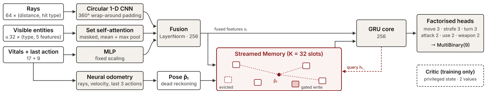

# BBB (Bictor Bon Boom)

**Budgeted, position-anchored spatial memory for zero-shot DOOM play.**
Our entry for *Yugaantar 2026 · DevForge, Track 1: "Can It Play DOOM?"*

📄 **[Full notes, training guide & model history](architecture.md)** · **[2-page brief (PDF)](docs/brief.pdf)** · [design notes](docs/BRIEF.md) · [environment findings](docs/FINDINGS.md) · [experiment log](docs/EXPERIMENTS.md)

BBB (Bictor Bon Boom) is a 1.07M-parameter recurrent agent. It plays DOOM levels it has never seen, using only ego-centric telemetry (rays, visible entities, and vitals) — no pixels and no global coordinates. It maintains **32 spatial memory slots**, each anchored to a pose estimated by a learned odometry network. Unmapped space allocates a new slot; once full, the least relevant slot is overwritten and slots are read by attention from the agent's current point of view.



## Highlights

- **Custom recurrent PPO** (no RL library) with an asymmetric privileged critic, separate extrinsic/intrinsic value heads, and a reward matched to the scoring categories.
- **Procedural map factory** with room graphs, doors, 1–3 key-and-lock chains, switch or walk-over exits, uneven floors, and Freedoom maps for variety.
- **Curriculum Director** focusing training on ~50% solve-rate scenarios, replaying failed "nemesis" seeds, and randomly mirroring episodes left-to-right.
- **Fast inference**: under 1 ms per decision on one CPU thread (budget: 40 ms), with 4.3 MB of weights.
- **Purely learned policy**: every action comes from the network, with no rule-based aiming or pathfinding.

## Results

Evaluated across two held-out sets of 249 episodes each (240 generated maps + 3 Freedoom maps across all four tiers, fixed seeds) using `submission/agent.py` (tiers weighted 1:2:3:4; estimated local weights):

| Tier | Earlier checkpoint (40.5M) | **Submitted (58.4M)** |
|---|---|---|
| 1 Combat | 143 · exit 92% | 142 · exit 93% |
| 2 Exploration | 128 · exit 70% | 129 · exit 70% |
| 3 Progression | 150 · exit 65% | **163 · exit 75%** |
| 4 Gauntlet | 102 · exit 35% | 107 · exit 39% |
| **Weighted** | 125.7 | **131.3** (+5.7, 95% CI 0.2 to 11.3) |

For memory ablations, known weaknesses, training details, and older checkpoints, see [architecture.md](architecture.md).

## Installation

### 1. Make sure Git LFS downloads the real model weights

All `*.pt` files are tracked with Git LFS. The latest submitted model (`submission/weights/model.pt`, 58.4M decisions, ~4.2 MB) is stored via Git LFS:

```bash
git lfs install
git clone https://github.com/VarchasHV/NOVA.git && cd NOVA
git lfs pull
```

> If `submission/weights/model.pt` is still a tiny pointer file (< 200 B), `submission/agent.py` will warn and fall back to an untrained network.

### 2. Install dependencies

Requires Python `>=3.13`. Install `vizdoom`, `torch`, and the local `doom-env` package with `uv`:

```bash
uv sync
```

*(Optional headless check)*:

```bash
uv run python validate.py
```

### 3. Run the latest model in a ViZDoom window

`tools/watch.py` opens a live 800×600 ViZDoom window with the HUD at real-time speed (35 tics/sec) on held-out maps:

```bash
uv run python tools/watch.py --ckpt submission/weights/model.pt
```

Useful options:
- `--mode greedy` — always picks the most likely action (steadier play; default `--mode sample` re-exports at `temperature=1.0`, whereas `submission/weights/model.pt` stores `temperature=0.5`)
- `--tier 1` (or `2`, `3`, `4`) — filter maps by tier (`1` Combat, `2` Exploration, `3` Progression, `4` Gauntlet)
- `--variety` — include maps with uneven shapes, steps, and ledges
- `--speed 2` — playback speed multiplier (`1.0` is real time)
- `--episodes 5` — stop after `5` maps (default loops until `Ctrl+C` or closing the window)

> **Note:** `tools/watch.py` passes `--ckpt` through `training/export.py`, which reads a training checkpoint's `counters["steps"]` key. When running the already-exported `submission/weights/model.pt`, it will print `trained for 0.0M decisions` in the terminal even though it is running the 58.4M-step model.

## Repository layout

| Folder | Contents |
|---|---|
| `submission/` | `DoomAgent` entry point, model definitions (`submission/models/`), and exported weights |
| `training/` | PPO, rewards, map generator, curriculum ([details](training/README.md)) |
| `evaluation/` | Held-out suite, local scorer, latency profiler |
| `configs/` | Experiment YAML configs |
| `tools/` | Live viewer (`watch.py`), dashboard, top-down visualizer, demo pages |
| `docs/` | Project brief, design notes, findings, experiment log, and official rules/contract |
| `env/`, `validate.py`, `maps/` | Official template files |

This repository was created from the official [devforge-doom-template](https://github.com/Reinforce-SST/devforge-doom-template) during the hackathon.
